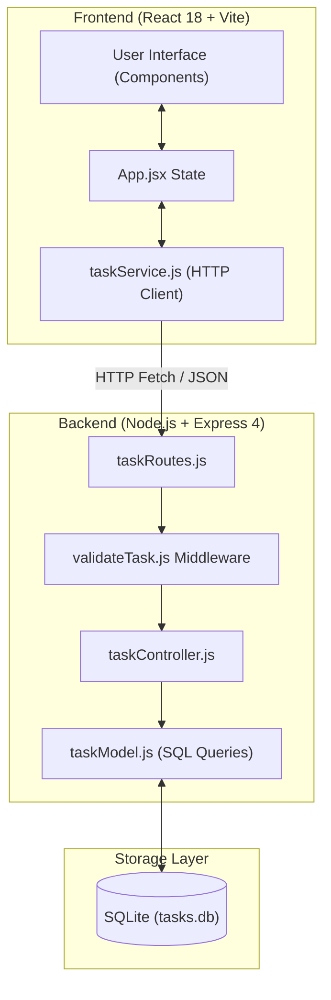

# <p align="center">Task-Flow</p>

<p align="center">
  <strong>A Clean, Full-Stack Personal Task Management Application</strong><br>
  <em>Designed and built with Node.js, Express, React, and SQLite.</em>
</p>

<p align="center">
  
  
  
  
</p>

<p align="center">
  
  
  
</p>

> 🔗 **Live Demo (Frontend):** [https://taskflow-mhjayeed.vercel.app/](https://taskflow-mhjayeed.vercel.app/)  
> ⚡ **Live API (Backend):** [https://task-flow-backend-itws.onrender.com/api/tasks](https://task-flow-backend-itws.onrender.com/api/tasks)

---

## 📖 Table of Contents

- [Overview](#-overview)
- [Key Features](#-key-features)
- [Tech Stack](#-tech-stack)
- [Prerequisites](#-prerequisites)
- [Step-by-Step Local Setup](#-step-by-step-local-setup)
- [Database Initialization & Seeding](#-database-initialization--seeding)
- [Running the Application](#-running-the-application)
- [Running Tests](#-running-tests)
- [API Reference](#-api-reference)
- [Database Schema](#-database-schema)
- [Project Structure](#-project-structure)
- [Architecture & Data Flow](#-architecture--data-flow)
- [Technical & Design Decisions](#-technical--design-decisions)
- [Deployment Guide](#-deployment-guide)
- [AI Assistance Disclosure](#-ai-assistance-disclosure)
- [Limitations & Future Roadmap](#-limitations--future-roadmap)
- [Author](#-author)

---

## 🌟 Overview

I built **Task-Flow** as a lightweight, reliable personal task manager. It allows a single user to manage day-to-day to-dos through a clean, distraction-free interface backed by a persistent SQLite database.

Rather than relying on `localStorage` or in-memory arrays, every create, read, update, status toggle, and delete action executes against a structured REST API. I focused on clean separation of concerns, writing parameterised SQL queries to prevent injection vulnerabilities, and implementing robust error handling and validation across both the client and server.

---

## ✨ Key Features

### Core Capabilities
- **View All Tasks:** Displays all saved tasks with their title, optional description, status badge, priority indicator, due date, and creation timestamp.
- **Create Tasks:** Form with instant client-side validation requiring a non-empty title before submission.
- **Status Toggle:** One-click toggle between `pending` and `completed` states with visual strikethrough and badge updates.
- **Inline Editing:** Edit any task's title, description, priority, or due date directly within the task card.
- **Safe Deletion:** Permanent task removal protected by a confirmation prompt to prevent accidental deletions.
- **Dual-Layer Validation:** Form inputs are validated in the browser for instant user feedback and on the server (`400 Bad Request`) to reject invalid API payloads.
- **Persistent Storage:** All records are stored in a local SQLite database file, preserving state across server restarts.

### Bonus Features
- **Status Filter Bar:** Quick client-side filter pills (`All`, `Pending`, `Completed`) with live task counts.
- **Priority Management:** Color-coded priority tags (`High`, `Medium`, `Low`) with automatic server-side sorting (High priority tasks appear first).
- **Due Dates & Overdue Detection:** Date selector for tasks, with prominent overdue warnings for past-due pending items.
- **Automated Integration Tests:** Comprehensive test suite covering all API endpoints and validation edge cases against an isolated in-memory database.

---

## 🛠 Tech Stack

| Layer | Choice | Reason for Selection |
|---|---|---|
| **Backend Runtime** | Node.js (v20+, ES Modules) | Fast asynchronous I/O and native ES module support (`import`/`export`). |
| **Backend Framework** | Express 4 | Minimal, battle-tested REST routing and middleware pipeline. |
| **Database** | SQLite via `better-sqlite3` | Zero-configuration embedded database. True persistence without requiring external database servers. |
| **Frontend Framework** | React 18 | Component-based UI with declarative state management (`useState`, `useEffect`). |
| **Frontend Build Tool** | Vite 5 | Fast development server and optimized production bundling. |
| **Styling** | Hand-crafted Vanilla CSS | Clean, custom styling with CSS variables and responsive design without heavy UI dependencies. |
| **Testing** | Node.js `node:test` + `node:assert` | Built-in test runner providing fast, zero-dependency integration testing. |

---

## 📋 Prerequisites

Before running the application locally, ensure you have the following installed:

- **Node.js**: `v20.0.0` or higher — [Download Node.js](https://nodejs.org/)
- **npm**: `v9.0.0` or higher (comes bundled with Node.js)
- **Git**: [Download Git](https://git-scm.com/)

Verify your environment by running:
```bash
node -v
npm -v
git --version
```

---

## 🚀 Step-by-Step Local Setup

### 1. Clone the Repository
```bash
git clone https://github.com/mhjayeed715/Task-Flow.git
cd Task-Flow
```

### 2. Configure and Install Backend
Navigate to the `backend` directory, set up your environment variables, and install the dependencies:
```bash
cd backend

# Create your local .env file from the provided example
cp .env.example .env    # On Windows PowerShell: copy .env.example .env

# Install backend dependencies
npm install
```

The default `backend/.env` file contains:
```env
PORT=4000
DB_PATH=./data/tasks.db
CORS_ORIGIN=http://localhost:5173
```

### 3. Configure and Install Frontend
Open a separate terminal window, navigate to the `frontend` directory, and install its dependencies:
```bash
cd frontend

# Create your local .env file from the provided example
cp .env.example .env    # On Windows PowerShell: copy .env.example .env

# Install frontend dependencies
npm install
```

The default `frontend/.env` file contains:
```env
VITE_API_URL=http://localhost:4000
```

---

## 🗄 Database Initialization & Seeding

I designed the database layer to be **completely automatic and self-initializing**:

1. **Automatic Schema Creation:**
   When the backend server boots (`npm start` or `npm run dev`), `src/db.js` checks if the database directory (`./data`) exists and creates it if necessary.
2. **Idempotent Table Setup:**
   It then reads `src/schema.sql` and executes `CREATE TABLE IF NOT EXISTS tasks (...)`.
3. **Zero Manual Setup:**
   You do not need to run manual migration scripts or import SQL dumps. The database file (`backend/data/tasks.db`) will be created automatically on your first run.

### Resetting the Database
If you ever want to wipe all records and start with a fresh database:
```bash
# From the backend directory
rm ./data/tasks.db      # On Windows PowerShell: Remove-Item ./data/tasks.db
```
Restarting the backend will automatically recreate a fresh `tasks.db` file.

---

## 💻 Running the Application

### 1. Start the Backend Server
From the `backend/` directory:
```bash
# Start in development mode (with auto-restart)
npm run dev

# Or start in standard production mode
npm start
```
The backend API will start on **`http://localhost:4000`**. You will see:
```text
Task-Flow server listening on port 4000
```

### 2. Start the Frontend Client
From the `frontend/` directory:
```bash
npm run dev
```
Vite will start the dev server, typically on **`http://localhost:5173`**. Open that URL in your browser to start using Task-Flow.

---

## 🧪 Running Tests

I wrote automated integration tests using Node.js's built-in `node:test` runner. The tests initialize a temporary in-memory database (`:memory:`), ensuring complete isolation from your local data.

To run the test suite:
```bash
cd backend
npm test
```

### Test Suite Coverage
```text
✔ POST valid task returns 201
✔ POST empty title returns 400
✔ GET lists tasks
✔ PATCH toggle flips status
✔ GET unknown id returns 404
✔ PUT unknown id returns 404
✔ DELETE unknown id returns 404
ℹ pass 7  fail 0
```

---

## 📡 API Reference

The backend exposes a standard RESTful HTTP API with JSON request and response bodies.

### Response Shape
- **Success:** `{ "data": ... }`
- **Error:** `{ "error": "Descriptive message" }`

### Endpoints

| Method | Endpoint | Request Body | Status Code | Description |
|---|---|---|---|---|
| `GET` | `/api/tasks` | *None* | `200 OK` | Retrieves all tasks, ordered by priority (High → Medium → Low) and newest creation date. |
| `POST` | `/api/tasks` | `{ title: string, description?: string, priority?: string, due_date?: string }` | `201 Created` | Creates a new task. Rejects empty titles with `400`. |
| `PUT` | `/api/tasks/:id` | `{ title?: string, description?: string, status?: string, priority?: string, due_date?: string }` | `200 OK` | Updates one or more fields on an existing task. |
| `PATCH` | `/api/tasks/:id/toggle` | *None* | `200 OK` | Toggles status between `pending` and `completed`. |
| `DELETE` | `/api/tasks/:id` | *None* | `200 OK` | Permanently deletes a task by ID. |

### HTTP Status Codes
- `200 OK`: Request succeeded.
- `201 Created`: New task successfully created.
- `400 Bad Request`: Validation failure (empty title, invalid status/priority, malformed JSON).
- `404 Not Found`: Task ID or requested route does not exist.
- `500 Internal Server Error`: Unhandled server exception.

---

## 🗃 Database Schema

The database consists of a single `tasks` table defined in `backend/src/schema.sql`:

```sql
CREATE TABLE IF NOT EXISTS tasks (
  id          INTEGER PRIMARY KEY AUTOINCREMENT,
  title       TEXT    NOT NULL,
  description TEXT,
  status      TEXT    NOT NULL DEFAULT 'pending'
                      CHECK (status IN ('pending', 'completed')),
  priority    TEXT    NOT NULL DEFAULT 'medium'
                      CHECK (priority IN ('low', 'medium', 'high')),
  due_date    TEXT,
  created_at  TEXT    NOT NULL DEFAULT CURRENT_TIMESTAMP,
  updated_at  TEXT    NOT NULL DEFAULT CURRENT_TIMESTAMP
);
```

- **Safety:** All queries use parameterised statements (`?` placeholders) through `better-sqlite3`, preventing SQL injection.
- **Integrity:** `CHECK` constraints enforce valid enum values at the database level.
- **Timestamps:** `created_at` defaults to insertion time; `updated_at` is updated automatically on every modification.

---

## 📂 Project Structure

```text
Task-Flow/
├── backend/
│   ├── src/
│   │   ├── controllers/
│   │   │   └── taskController.js    # Request handlers / HTTP business logic
│   │   ├── middleware/
│   │   │   ├── errorHandlers.js     # 404 handler and global 500 error boundary
│   │   │   └── validateTask.js      # Request body schema validation (POST & PUT)
│   │   ├── models/
│   │   │   └── taskModel.js         # Parameterised SQL queries and database interactions
│   │   ├── routes/
│   │   │   └── taskRoutes.js        # Express route definitions mapping to controller methods
│   │   ├── app.js                   # Express application factory (allows in-memory test builds)
│   │   ├── db.js                    # Database connection manager and schema initializer
│   │   ├── schema.sql               # SQLite table definitions and constraints
│   │   └── server.js                # Server entry point (reads .env, starts listener)
│   ├── tests/
│   │   └── tasks.test.js            # Automated integration tests using node:test
│   ├── .env.example                 # Example environment variables for backend
│   ├── .node-version                # Pinned Node.js 20 LTS version for cloud deployment
│   └── package.json
│
├── frontend/
│   ├── src/
│   │   ├── components/
│   │   │   ├── FilterBar.jsx        # Status filter pills (All, Pending, Completed)
│   │   │   ├── TaskForm.jsx         # Task creation form with inline validation
│   │   │   ├── TaskItem.jsx         # Task card, inline editing, toggle, and delete confirm
│   │   │   └── TaskList.jsx         # Renders filtered task list or empty states
│   │   ├── services/
│   │   │   └── taskService.js       # Centralized fetch wrapper for all backend API calls
│   │   ├── App.jsx                  # Root state management, notification toasts, and actions
│   │   ├── index.css                # Hand-written vanilla CSS stylesheet (responsive layout)
│   │   └── main.jsx                 # React DOM mount point
│   ├── .env.example                 # Example environment variables for frontend
│   ├── index.html                   # HTML entry point with semantic layout
│   ├── package.json
│   └── vite.config.js
│
├── .gitignore                       # Clean gitignore (excludes node_modules, .env, DB files)
└── README.md                        # Documentation and setup guide
```

---

## 🏗 Architecture & Data Flow



---

## 🧠 Technical & Design Decisions

### 1. Why SQLite and `better-sqlite3`?
I wanted an authentic, persistent SQL database that does not force the evaluator to install Docker or configure external database credentials. `better-sqlite3` is synchronous, fast, and creates the database file locally on first launch. It satisfies the persistence requirement with zero friction.

### 2. Why a Layered Architecture (Routes → Controllers → Models)?
Rather than putting database calls directly into Express route handlers, I separated concerns into three layers:
- **Routes:** Define the RESTful URL structure and attach middleware.
- **Controllers:** Validate HTTP requests, parse query parameters, call models, and construct HTTP responses.
- **Models:** Own all raw SQL queries and data transformations.
This makes the code easy to read, maintain, and test independently.

### 3. Why an Application Factory (`buildApp`)?
In `backend/src/app.js`, I exported a `buildApp(dbPath)` function instead of binding the server directly to a hardcoded database path. This allows my test suite to invoke `buildApp(':memory:')` to spin up a completely isolated, lightning-fast in-memory database for each test run without touching the development database file.

### 4. Why Hand-Written Vanilla CSS?
Instead of installing Tailwind or component libraries, I wrote a custom, clean stylesheet in `index.css`. This allowed me to keep bundle size small, ensure fast load times, and demonstrate solid foundational understanding of CSS Flexbox, Grid, CSS variables, and media queries for responsive mobile layouts.

### 5. Why Client-Side Filtering?
Because personal task lists typically contain dozens to hundreds of items, filtering in the browser provides an instantaneous user experience with zero network latency. The full list is retrieved once and kept in sync with each mutation.

---

## ☁️ Deployment Guide

### Live Deployments
- **Frontend App:** [https://taskflow-mhjayeed.vercel.app/](https://taskflow-mhjayeed.vercel.app/) (Hosted on Vercel)
- **Backend API:** [https://task-flow-backend-itws.onrender.com/api/tasks](https://task-flow-backend-itws.onrender.com/api/tasks) (Hosted on Render)

### Deploying the Backend (Render)
1. In [Render](https://render.com), create a new **Web Service** connected to your repo.
2. Configuration:
   - **Root Directory:** `backend`
   - **Build Command:** `npm install`
   - **Start Command:** `npm start`
3. Environment variables:
   - `NODE_VERSION` = `20.18.0`
   - `PORT` = `4000`
   - `DB_PATH` = `./data/tasks.db`
   - `CORS_ORIGIN` = `https://taskflow-mhjayeed.vercel.app`

### Deploying the Frontend (Vercel)
1. In [Vercel](https://vercel.com), import your repository.
2. Configuration:
   - **Root Directory:** `frontend`
   - **Framework Preset:** Vite
3. Environment variable:
   - `VITE_API_URL` = `https://task-flow-backend-itws.onrender.com`
4. Click **Deploy**.

---

## 🤖 AI Assistance Disclosure

In accordance with the assignment guidelines, I am transparently disclosing my use of AI tooling:

- I used **Claude Code** as an AI pair-programming assistant to assist with initial project scaffolding and to help craft the date-parsing and regular expression checks in `backend/src/middleware/validateTask.js`.
- I personally reviewed, understood, and refined every single file, route, and component across the repository.
- I verified the test suite using `node:test` and manually exercised each endpoint using `curl` and browser interactions.
- I am confident in this architecture and prepared to explain every design decision, SQL query, and implementation detail in a technical interview.

---

## ⚠️ Limitations & Future Roadmap

Given the scope of the brief, I prioritized core reliability, clean architecture, and test coverage over feature bloat. If extending this project in the future, I would implement:
- **Authentication:** Multi-user support with JWT authentication and per-user task isolation.
- **Hosted Database:** Switching from SQLite to PostgreSQL for multi-instance deployment.
- **Server-Side Pagination & Search:** Pagination and debounced full-text search for large task lists.
- **Drag-and-Drop Reordering:** Visual task reordering within priority columns.
- **WebSockets / Polling:** Real-time multi-tab synchronization.

---

## 👨‍💻 Author

**S. M. Mehrab Hossain Jayeed**
- GitHub: [@mhjayeed715](https://github.com/mhjayeed715)
- Repository: [Task-Flow on GitHub](https://github.com/mhjayeed715/Task-Flow)
